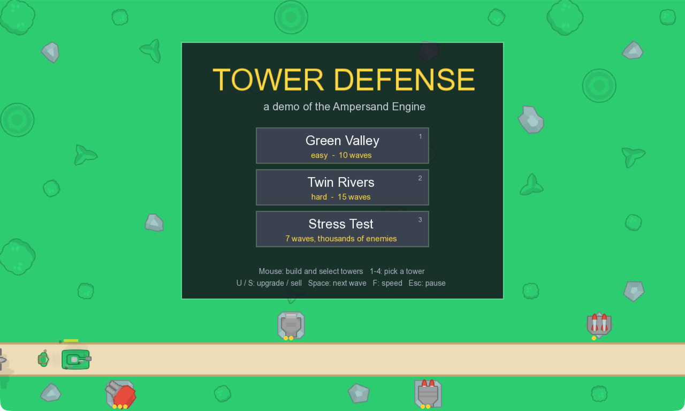

# Tower Defense POC



A tower defense game built on the [Ampersand Engine](https://github.com/Boz0o0/Ampersand-Engine).
Build and upgrade four kinds of towers to stop waves of ground and air
enemies across three levels, including a Stress Test with thousands of
enemies. The game is almost entirely data (`world/`) and Lua scripts
(`scripts/`); the C++ in `src/` only sets up the engine.

## Getting started

Requires CMake 3.24+ and a C++20 compiler; the engine is fetched at configure
time.

```sh
cmake -S . -B build
cmake --build build --parallel
./build/tower_defense
```

Run it from the root of the repository.

| Input            | Action                                |
| ---------------- | ------------------------------------- |
| Left click       | build, select a tower, press a button |
| `1`–`4`, `Q`/`E` | pick a tower                          |
| `U` / `S`        | upgrade / sell                        |
| `Space`          | next wave                             |
| `F`              | speed x1 / x2                         |
| `Esc`            | cancel or pause                       |
| `Tab`            | show the engine stats                 |
